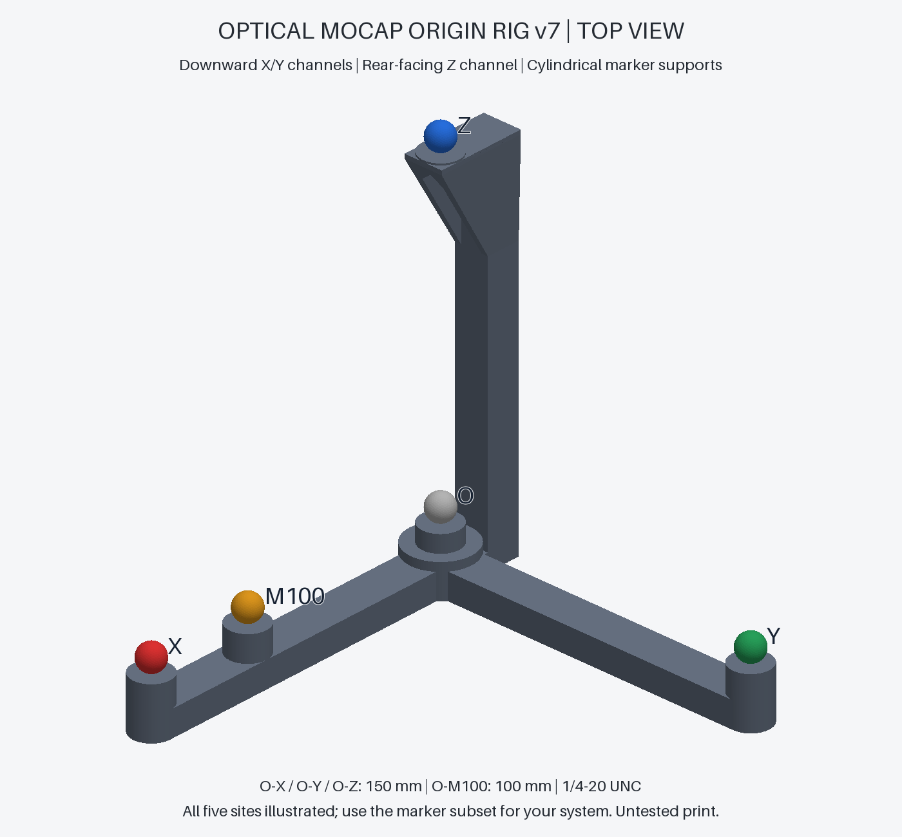
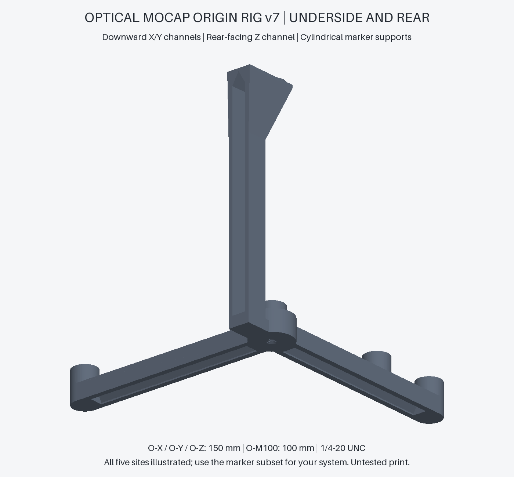

# Optical Motion-Capture Origin Rig — 150 mm

3D-printable origin and ground-plane reference · Vicon Nexus / OptiTrack Motive workflows

A printable, tripod-mounted five-position coordinate reference for **passive optical motion-capture systems**, originally designed for Vicon Nexus origin setting after camera calibration. Use with other systems depends on marker reconstruction and the supported origin workflow; see the compatibility table below. The current design, **v7**, uses cylindrical adhesive-marker supports, downward-facing pointed channels, and a printed female 1/4-20 UNC tripod socket.

**Status: digitally checked prototype.** The released STL files have passed mesh checks. Slicing, physical ABS printing, dimensional inspection, mechanical testing, and use in Nexus, Motive or other systems have **not yet been validated**. This project is not a camera-calibration wand or a certified dimensional reference.



## Download and start

Download the repository with **Code → Download ZIP**, or clone it. Prebuilt files are in [`models/`](models/); Python is only needed to rebuild or modify them.

| File | Purpose |
| --- | --- |
| [origin_rig_v7.stl](models/origin_rig_v7.stl) | Complete rig, one connected body |
| [roof_coupon_60deg.stl](models/roof_coupon_60deg.stl) | Small 24 × 18 × 12 mm sample of the actual horizontal channel |
| [thread_coupon_quarter_20.stl](models/thread_coupon_quarter_20.stl) | Minimal Ø12 × 12 mm thread-fit sample |

1. Read the [printing guide](docs/printing.md) and check your marker bases and tripod screw.
2. Import the coupons into Bambu Studio **in millimetres at 100% scale**. Use the same ABS and profile planned for the rig.
3. Print and inspect the coupons; inspect the full rig's sliced layers separately.
4. Print the rig, let it cool, measure it, and mount the marker subset required by your software.
5. Read the [system compatibility guide](docs/compatibility.md), then follow the appropriate origin procedure and verify orientation.

## What it does

The rig provides marker positions **O, X, Y, Z**, plus **M100** at 100 mm along the X arm. One full-rig STL serves both workflows. Nominal O-to-axis-marker distances are 150 mm. Nexus's documented *Three Markers* origin procedure selects **O → X → Z**; Y is an additional orientation/check marker. Camera calibration must already have been completed with an appropriate device, such as the existing Active Wand. See the [Vicon instructions](https://vicon-help.atlassian.net/wiki/spaces/Nexus215/pages/11374576/Set%2Bthe%2Bvolume%2Borigin).

The origin is the **centre reconstructed for marker O**, not the bottom of the print or the tripod plate. Identical markers and equal adhesive thickness are essential to the nominal coordinate relationships.

## System compatibility

| Workflow | v7 status |
| --- | --- |
| Vicon Nexus manual Three Markers | Intended workflow; documented selection matches the design. Hardware testing pending. |
| OptiTrack Motive Custom Calibration Square | Use O, M100 and Y150: a nominal 90° triangle with 100/150 mm arms. Meets documented geometry; hardware validation pending. |
| OptiTrack Motive rigid-body origin | The fifth position breaks the original four-marker symmetry when populated. Asset setup and reacquisition remain unvalidated. |
| Other passive optical systems / exported labelled coordinates | Potential coordinate reference; check marker detection, labelling, axis convention and software procedure for each setup. |

See the [OptiTrack assessment and official sources](docs/optitrack-workflow.md) and the [system-independent coordinate-frame method](docs/compatibility.md). No universal or manufacturer-certified compatibility is claimed. The model is a reference frame, not a camera-calibration wand.

## Specification

| Property | Current reference design |
| --- | --- |
| Printer/material target | Bambu Lab X1E; Bambu ABS black |
| Nominal marker diameter | 12 mm; actual marker shape/base still needs confirmation |
| Adhesive mounting faces | Four horizontal Ø18 mm faces |
| O–X / O–Y / O–Z | 150 mm each, nominal centre-to-centre |
| Overall envelope | 191 × 174 × 174 mm |
| Lower supports | Constant-diameter Ø18 mm cylinders |
| Horizontal channels | Open downward, pointed roof at 60° **from the build plate** |
| Vertical channel | Continuous rear opening; pointed upper closure |
| Tripod socket | Printed right-hand 1/4-20 UNC-style fit, 11 mm blind depth |
| Thread allowance | 0.20 mm **radial**, to be checked on the coupon |
| Released solid mesh volume | Approximately 101.35 cm³; not a slicer filament estimate |

The upper bracket projects forward because the tower is offset behind O. This keeps Z directly above O. The top marker pad is backed across its footprint; there is no unsupported 1 mm side lip.



## Documentation

- [Design, coordinates and dimensions](docs/design.md)
- [Bill of materials, printing and assembly](docs/printing.md)
- [System compatibility and coordinate conventions](docs/compatibility.md)
- [OptiTrack / Motive assessment and limitations](docs/optitrack-workflow.md)
- [Nexus setup, orientation and troubleshooting](docs/nexus-workflow.md)
- [Validation evidence and physical test plan](docs/validation.md)
- [Rebuilding, modifying and testing the CAD](docs/development.md)
- [Sources and attribution](docs/references.md)
- [Release notes](CHANGELOG.md) and [contributing](CONTRIBUTING.md)

## Rebuild and test

Use Python 3.12 in an isolated environment. From the repository root:

```sh
python -m venv .venv
# Activate .venv using the command for your operating system.
python -m pip install -r requirements.txt
python scripts/build.py
python -m unittest discover -s tests -v
python scripts/check_repository.py
```

Generated output goes to `build/`; the tracked reference STLs are not overwritten. See [development](docs/development.md) for activation commands, geometry tolerances, thread adjustments and release packaging. The GitHub Actions workflow runs digital checks only; its presence is not evidence that it has run on GitHub yet.

## Validation boundaries

A closed, manifold STL is only a valid digital solid. It does not establish printability, layer bonding, marker visibility, stiffness, orthogonality after shrinkage, or measurement-system accuracy. A successful small coupon also does not establish the performance of a full-size ABS print. The [validation report](validation/geometry_report.json) and [test record template](validation/physical-test-record.csv) keep these stages separate.

## License and independence

**Code:** [MIT](LICENSES/MIT.txt). **CAD models, generated STLs, documentation and images:** [CC BY 4.0](LICENSES/CC-BY-4.0.txt). See [LICENSE](LICENSE) for scope and [NOTICE.md](NOTICE.md) for attribution.

This is an independent project. It is not an official Vicon, OptiTrack or Bambu Lab accessory and is not endorsed by these manufacturers. Manufacturer trademarks identify the intended software, printer and material only. Third-party manuals are linked, not redistributed.

## Repository layout

| Folder | Contents |
| --- | --- |
| `models/` | One complete v7 rig STL and two small print coupons |
| `src/` | Standalone editable CAD geometry |
| `scripts/` | Build, preview, validation and packaging tools |
| `tests/` | Geometry regression checks |
| `docs/` | English design, printing, system workflows and publishing guide; preview images |
| `validation/` | Digital check results, asset hashes and blank physical test record |
| `LICENSES/` | MIT and CC BY 4.0 license texts |
| `.github/` | Automated checks and issue templates |

Local `dist/` contains only the current release ZIP and checksum and is excluded from Git. Temporary `build/` output is regenerated when needed. Earlier design revisions are described in the changelog; the printable model folder contains only the current full rig.
